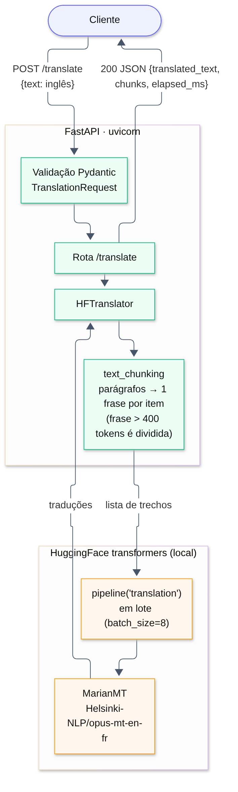
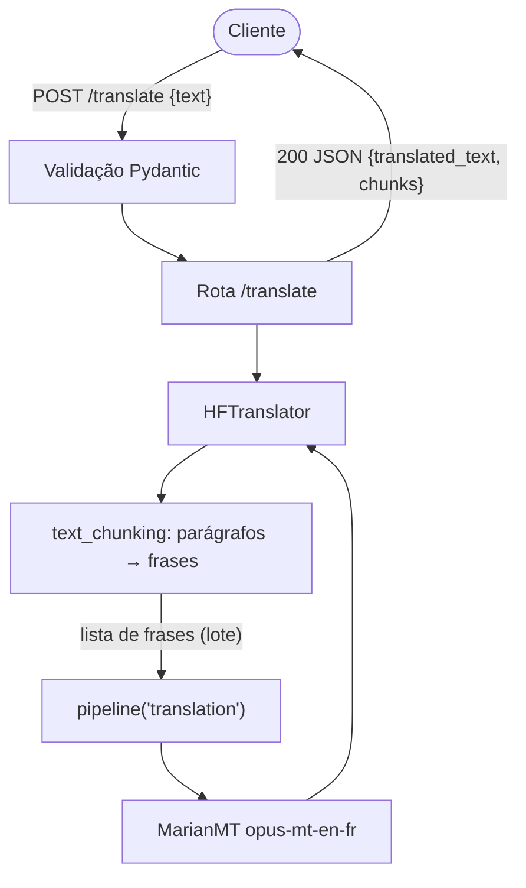

# Parte 1 · Questão 2 — Tradução EN → FR com Helsinki-NLP/opus-mt-en-fr (FastAPI)

API em **FastAPI** que recebe um texto em inglês e devolve a tradução em francês usando o modelo
**Helsinki-NLP/opus-mt-en-fr** (MarianMT) via HuggingFace `transformers`. Processa **frases curtas e
textos longos** (vários parágrafos).

## Arquitetura



<details><summary>Código Mermaid do diagrama</summary>


</details>

### Como textos longos são tratados

O modelo aceita no máximo **512 tokens** por entrada e foi treinado com pares de **frases**. Nos testes,
um parágrafo de 4 frases enviado inteiro teve a **última frase omitida** na tradução. Por isso a API:

1. divide o texto em **parágrafos** (linhas em branco);
2. divide cada parágrafo em **frases**, e cada frase vira um item do lote (frases com mais de 400 tokens são quebradas por palavras);
3. traduz **todas as frases em lote** (`batch_size=8`), aproveitando melhor a CPU/GPU;
4. remonta o texto preservando os parágrafos.

## Estrutura

```
app/
├── main.py           # FastAPI: lifespan, /translate, /health
├── translator.py     # HFTranslator (pipeline de tradução + lote)
├── text_chunking.py  # segmentação parágrafo → frase (funções puras, testadas)
├── schemas.py        # modelos Pydantic
└── config.py         # APP_HF_MODEL, APP_DEVICE, APP_MAX_CHUNK_TOKENS, APP_BATCH_SIZE
tests/                # testes da segmentação, da API (tradutor falso) e de integração
```

## Como executar

Pré‑requisito: Python 3.10+. O modelo (~300 MB) é baixado na primeira execução.

```bash
python -m venv .venv
```

```bash
source .venv/bin/activate        # Windows: .venv\Scripts\activate
```

```bash
pip install torch --index-url https://download.pytorch.org/whl/cpu   # opcional: PyTorch só CPU
```

```bash
pip install -r requirements.txt
```

```bash
uvicorn app.main:app --reload
```

Swagger: http://127.0.0.1:8000/docs

> `transformers` está fixado em `<5` porque a versão 5 removeu o pipeline `translation`.

### Exemplos (respostas reais, CPU 4 núcleos)

```bash
curl -X POST http://127.0.0.1:8000/translate -H "Content-Type: application/json" -d '{"text": "Hello! How are you today?"}'
```

```json
{"source_language":"en","target_language":"fr","original_text":"Hello! How are you today?","translated_text":"Bonjour ! Comment allez-vous aujourd'hui ?","model":"Helsinki-NLP/opus-mt-en-fr","chunks":2,"elapsed_ms":276.76}
```

Texto com dois parágrafos:

```json
{
  "translated_text": "L'intelligence artificielle transforme la façon dont les entreprises construisent des logiciels. Les développeurs utilisent maintenant des modèles de langue pour écrire du code.\n\nCependant, ces outils font toujours des erreurs, de sorte que l'examen humain reste essentiel.",
  "model": "Helsinki-NLP/opus-mt-en-fr",
  "chunks": 3,
  "elapsed_ms": 808.34
}
```

### Testes

```bash
pytest -q
```

```bash
RUN_INTEGRATION=1 pytest -q     # inclui frase curta + texto longo com o modelo real
```

### Qualidade de código

O projeto usa o [ruff](https://docs.astral.sh/ruff/) (configuração em `ruff.toml`) como linter e formatador:

```bash
pip install ruff && ruff check . && ruff format --check .
```

## Referências

- Model card: https://huggingface.co/Helsinki-NLP/opus-mt-en-fr (licença Apache‑2.0)
- Uso de IA: desenvolvido com apoio do assistente Claude (Anthropic) como ferramenta de apoio; o código foi revisado, testado e é compreendido pelo autor.
